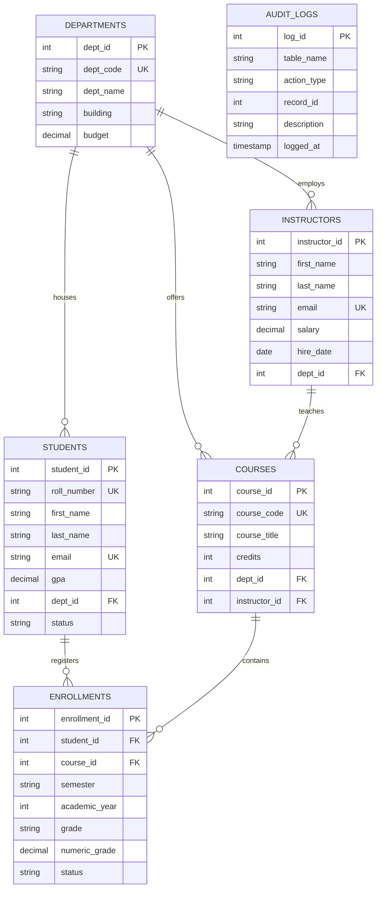

#  EduTrack DBMS — University Database Management System

A normalized Relational Database Management System (RDBMS) project built with **SQLite 3**, **Python/Flask**, and an **Interactive Web Dashboard**.

---

##  Key Highlights & DBMS Concepts Demonstrated

| Feature / Concept | Description |
|---|---|
| **Normalization (3NF)** | Fully normalized schema avoiding update, insert, and deletion anomalies. |
| **Referential Integrity** | Primary Keys, Foreign Keys, `ON DELETE RESTRICT`, and `ON DELETE CASCADE`. |
| **Triggers (Active Rules)** | 1) `trg_after_enrollment_grade_update` dynamically recalculates GPA.<br>2) `trg_after_student_insert` logs registrations into `audit_logs`. |
| **Database Views** | 1) `v_student_transcript` (Multi-table JOIN View)<br>2) `v_department_summary` (Aggregated statistics View)<br>3) `v_course_stats` (Enrollment analytics View) |
| **B-Tree Indexes** | Performance indexes on search keys, foreign keys, and roll numbers. |
| **Interactive SQL Playground** | Execute raw SQL queries (SELECT, DML, DDL) in real-time with timing metrics. |
| **ER Diagram Visualizer** | Interactive schema viewer with live SQLite schema catalog inspection. |
| **Academic Viva Kit** | In-app viva Q&A and 30+ preloaded standard lab SQL queries. |

---

## Quick Start (One-Click Run)

### Prerequisites
- Python 3.8+ (Preinstalled on macOS/Linux/Windows)

### Start the Application
Open your terminal and run:

```bash
cd /Users/apple/.gemini/antigravity-ide/scratch/student_dbms_project
./run.sh
```

Or using Python directly:

```bash
python3 -m venv venv
./venv/bin/pip install -r requirements.txt
./venv/bin/python app.py
```

Open your browser and navigate to: **[http://127.0.0.1:5050](http://127.0.0.1:5050)**

---

##  Entity-Relationship (ER) Diagram



---

##  Project Structure

```
student_dbms_project/
├── app.py                     # Flask Web Application & REST API
├── database.py                # Database Manager & Raw SQL Executor
├── schema.sql                 # DDL: Tables, Constraints, Triggers, Views & Indexes
├── seed_data.sql              # Realistic seed data for university simulation
├── queries_viva.sql           # 30+ Standard DBMS Viva & Lab queries
├── VIVA_GUIDE.md              # Complete Viva Q&A, Theory & Normalization notes
├── requirements.txt           # Python dependencies
├── run.sh                     # Executable startup launcher
├── static/
│   ├── css/
│   │   └── style.css          # Glassmorphism dark-mode responsive design
│   └── js/
│       └── app.js             # Client-side SQL execution & dynamic modals
└── templates/
    ├── base.html              # Core navigation & layout
    ├── index.html             # Analytics Dashboard & Trigger stream
    ├── students.html          # Student Management & Transcripts
    ├── courses.html           # Course & Department Catalog
    ├── enrollments.html       # Enrollment & Live Grading System
    ├── sql_console.html       # SQL Playground Terminal
    ├── er_diagram.html        # Interactive Schema & ER Viewer
    └── viva_prep.html         # In-App Viva & Theory Preparation
```

---

##  Testing the DBMS Trigger

1. Navigate to **Enrollments & Grades** in the web interface.
2. Select any enrollment and click **⭐ Assign Grade**.
3. Change the grade (e.g., from `B` to `A+`).
4. Notice the student's cumulative GPA is automatically updated across the entire system via the `trg_after_enrollment_grade_update` trigger.
5. Check the **Dashboard** to see the event recorded in the **DBMS Trigger Audit Trail**.

---

##  License
Open-source academic template for Computer Science & Engineering students.
